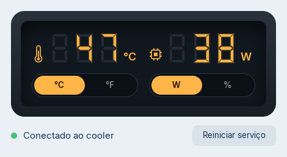

# cpu temp rise mode - Adaptador Linux

   

🌐 **Site com passo a passo para iniciantes:** https://cputemp-adp.netlify.app

Driver não oficial para Linux do **display digital do Rise Mode Air Cooler Temp 6** (e outros coolers Rise Mode com o mesmo display — USB `1A2C:4984`).

O software oficial ("CPU TEMP Monitor") só existe para Windows. Sem ele, o display do cooler fica apagado ou parado no Linux. Este projeto reimplementa o protocolo em **um único script Python, sem dependências**, que roda como serviço do sistema e mostra no display:

- 🌡️ **Temperatura da CPU** em °C ou °F
- ⚡ **Consumo da CPU em Watts** ou 📊 **uso da CPU em %**

Desde a 2.0 tem também um **painel gráfico** para ver as leituras e trocar °C/°F e W/% sem usar o terminal.



> ⚠️ Projeto independente, feito por engenharia reversa para interoperabilidade. **Não é afiliado, endossado ou suportado pela Rise Mode.** Use por sua conta e risco.

---

## Sumário

1. [Compatibilidade](#compatibilidade)
2. [Requisitos](#requisitos)
3. [Instalação rápida](#instalação-rápida)
4. [Instalação passo a passo](#instalação-passo-a-passo)
5. [Atualização](#atualização)
6. [Uso no dia a dia](#uso-no-dia-a-dia)
7. [Painel](#painel)
8. [Configuração](#configuração)
9. [Comandos do script](#comandos-do-script)
10. [Solução de problemas](#solução-de-problemas)
11. [Desinstalação](#desinstalação)
12. [Como funciona (protocolo)](#como-funciona-protocolo)
13. [Arquitetura (daemon e painel)](#arquitetura-daemon-e-painel)
14. [Arquivos do projeto](#arquivos-do-projeto)
15. [Contribuindo](#contribuindo)
16. [Versões](#versões)

---

## Compatibilidade

| Item | Status |
|---|---|
| Rise Mode Air Cooler Temp 6 (Black) | ✅ Testado |
| Outros coolers Rise Mode com display `1A2C:4984` | 🟡 Deve funcionar (mesmo software oficial) |
| CPU Intel (sensor `coretemp`) | ✅ Testado |
| CPU AMD Ryzen (sensor `k10temp` / `zenpower`) | 🟡 Suportado, não testado ainda |
| Zorin OS 17 | ✅ Testado |
| Ubuntu, Linux Mint, Pop!_OS, Debian, Fedora, Arch… | 🟡 Deve funcionar (qualquer distro com systemd) |

Testou em outro hardware ou distro? [Abra uma issue](../../issues) contando o resultado.

**Como saber se o seu cooler é compatível:** com ele conectado, rode

```bash
lsusb | grep -i 1a2c:4984
```

Se aparecer uma linha, o display usa este protocolo.

---

## Requisitos

- Linux com **systemd** (praticamente todas as distros atuais)
- **Python 3.6+** (já vem instalado em quase todas as distros)
- Cooler conectado em um **header USB interno** da placa-mãe (o cabo USB 9 pinos que acompanha o cooler)

Não precisa instalar nenhuma biblioteca. O script fala direto com o kernel via `/dev/hidraw` e lê os sensores em `/sys`.

O **painel** (opcional) precisa do PyGObject com GTK 4 ou GTK 3. Ele já vem instalado no Zorin, no Ubuntu e no Mint. Se faltar, o instalador avisa e instala só o adaptador. Para instalar o que falta:

```bash
sudo apt install python3-gi gir1.2-gtk-4.0
```

---

## Instalação rápida

1. Baixe o `risemode-cooler-linux.tar.gz` na [página de releases](../../releases) ou no site.
2. Abra o terminal (`Ctrl+Alt+T`) e cole:

```bash
cd ~ && rm -rf risemode-cooler-linux && tar xzf "$(find ~ -maxdepth 3 -name 'risemode-cooler-linux*.tar.gz' -printf '%T@ %p\n' 2>/dev/null | sort -nr | head -1 | cut -d' ' -f2-)" && cd risemode-cooler-linux && sudo ./install.sh
```

3. Digite sua senha quando pedir (ela não aparece enquanto você digita, é normal).

Pronto. O display passa a mostrar a temperatura em poucos segundos, e o serviço liga sozinho toda vez que o PC iniciar. Pode fechar o terminal.

Para abrir o painel, aperte a tecla **⊞ Windows**, digite **Rise Mode** e clique em **Rise Mode Cooler**. Veja a seção [Painel](#painel).

O comando acha o arquivo baixado mais recente em qualquer pasta (`Downloads`, `Transferências`…), extrai e instala.

---

## Instalação passo a passo

Para quem prefere fazer manualmente ou quer conferir cada etapa.

### 1. Extraia

```bash
cd ~/Downloads        # ou ~/Transferências, dependendo do idioma do sistema
tar xzf risemode-cooler-linux.tar.gz
cd risemode-cooler-linux
```

### 2. Verifique se o cooler e o sensor foram encontrados

```bash
sudo python3 risemode-cooler.py --info
```

Saída esperada (os números de `hidraw` e `hwmon` mudam de PC para PC):

```
Dispositivo HID : /dev/hidraw5
Sensor de temp  : /sys/class/hwmon/hwmon1/temp1_input
RAPL (potencia) : /sys/class/powercap/intel-rapl:0/energy_uj
Firmware        : 0x...
```

### 3. Teste o display (opcional)

```bash
sudo python3 risemode-cooler.py --test 42 65
```

O display deve mostrar **42** e **65**. O comando fica rodando até você apertar `Ctrl+C`. Ele não travou.

### 4. Instale o serviço

```bash
sudo ./install.sh
```

O instalador:

- copia o script para `/usr/local/bin/risemode-cooler`
- cria uma regra udev (`/etc/udev/rules.d/99-risemode-cooler.rules`) que libera o acesso ao cooler
- cria a configuração `/etc/risemode-cooler/config.json` (se ainda não existir; na atualização da 1.x, traz o `RM_UNIT`, o `RM_MODE` e o `RM_INTERVAL` que você já usava)
- instala o helper `/usr/local/lib/risemode-cooler/set-config` e a permissão do polkit, que o painel usa para salvar a configuração
- instala o painel, o atalho no menu e o ícone (se o PyGObject existir)
- registra, ativa e (re)inicia o serviço systemd `risemode-cooler`

Se aparecer `Active: active (running)`, está funcionando.

---

## Atualização

Baixe o arquivo novo e rode **o mesmo comando da instalação rápida**. Suas preferências são mantidas e o serviço é reiniciado automaticamente. Vindo da 1.x, o instalador copia o `RM_UNIT`, o `RM_MODE` e o `RM_INTERVAL` do `/etc/default/risemode-cooler` para o novo `/etc/risemode-cooler/config.json`.

Para conferir a versão instalada:

```bash
risemode-cooler --version
```

---

## Uso no dia a dia

**Você não precisa fazer nada.** Depois de instalado:

- o serviço inicia sozinho no boot, em segundo plano
- não precisa deixar terminal aberto
- se o cooler for desconectado e reconectado, ele reconecta sozinho em ~3 segundos
- se o chip do display travar e parar de aceitar dados, ele reinicia o USB do cooler sozinho, e o display volta em poucos segundos (v1.1+)

Comandos úteis:

```bash
systemctl status risemode-cooler           # ver se está rodando
journalctl -u risemode-cooler -n 20        # ver os últimos logs
sudo systemctl restart risemode-cooler     # reiniciar (após mudar a config)
sudo systemctl stop risemode-cooler        # parar temporariamente
sudo systemctl disable --now risemode-cooler  # parar e não iniciar mais no boot
```

---

## Painel

**Como abrir:** aperte a tecla **⊞ Windows** (ou clique no menu de aplicativos, no canto da tela), digite **Rise Mode** e clique em **Rise Mode Cooler**. Pelo terminal, o comando é `risemode-cooler-panel`.

Para achar mais rápido depois: com o painel aberto, clique com o botão direito no ícone dele na barra de tarefas e escolha **Fixar** (ou **Adicionar aos favoritos**).


- Os números são os mesmos que estão no display do cooler, atualizados a cada segundo.
- Clique em **°C / °F** ou **W / %** para mudar o que o display mostra. Na primeira vez, o sistema pede sua senha. Depois ele lembra por alguns minutos.
- A mudança aparece no cooler em 1 ou 2 segundos. Não precisa reiniciar nada.
- Se você cancelar a senha, nada muda.
- **Reiniciar serviço** serve para quando o display parou e não voltou sozinho.

Embaixo aparece o estado do adaptador:

| Mensagem | O que significa |
|---|---|
| Conectado ao cooler | Tudo certo |
| Display travou, recuperando… | O chip do display travou. O adaptador destrava sozinho em poucos segundos |
| Cooler não encontrado. Confira o cabo USB interno. | O cooler não aparece no USB |
| Serviço parado | O adaptador não está rodando. Clique em **Reiniciar serviço** |

O painel é opcional. Sem ele, o display funciona do mesmo jeito.

---

## Configuração

O jeito mais fácil é pelo [painel](#painel). Pelo terminal, use o mesmo helper que o painel usa. A mudança vale na hora, sem reiniciar:

```bash
sudo /usr/local/lib/risemode-cooler/set-config unit=F          # Fahrenheit
sudo /usr/local/lib/risemode-cooler/set-config mode=%          # uso em %
sudo /usr/local/lib/risemode-cooler/set-config interval=2      # a cada 2 s
```

A configuração fica em `/etc/risemode-cooler/config.json`:

```json
{"unit": "C", "mode": "W", "interval": 1}
```

| Opção | Valores | Padrão | O que faz |
|---|---|---|---|
| `unit` | `C`, `F` | `C` | Temperatura em Celsius ou Fahrenheit (acende o ícone correspondente no display) |
| `mode` | `W`, `%` | `W` | Mostra a potência da CPU em Watts ou o uso em porcentagem |
| `interval` | 1 a 10 | `1` | Segundos entre cada atualização |

Opções avançadas continuam no `/etc/default/risemode-cooler` (depois de mudar, rode `sudo systemctl restart risemode-cooler`):

| Opção | Valores | Padrão | O que faz |
|---|---|---|---|
| `RM_SENSOR` | caminho | automático | Força um sensor de temperatura específico |
| `RM_DEVICE` | `/dev/hidrawN` | automático | Força um dispositivo específico |

As variáveis `RM_UNIT`, `RM_MODE` e `RM_INTERVAL` da 1.x ainda funcionam se o `config.json` não existir. Ordem de prioridade: opções da linha de comando > `config.json` > `RM_*` > padrão.

> **Sobre o modo W:** a potência é lida via RAPL (`/sys/class/powercap`), disponível em CPUs Intel e AMD Zen. Se sua CPU não suportar, o script muda automaticamente para `%` e avisa no log.

---

## Comandos do script

O script também pode ser usado manualmente (útil para testes e diagnóstico):

```bash
sudo risemode-cooler [opções]
# ou, de dentro da pasta extraída:
sudo python3 risemode-cooler.py [opções]
```

| Opção | Descrição |
|---|---|
| `--info` | Mostra o dispositivo, o sensor, o RAPL e a versão do firmware, e sai |
| `--test TEMP VALOR` | Envia valores fixos para testar o display (ex.: `--test 42 65`) |
| `--dry-run` | Lê os sensores e mostra os pacotes, mas não envia nada ao cooler |
| `-v`, `--verbose` | Mostra cada leitura enviada |
| `--unit C\|F` | Unidade da temperatura |
| `--mode W\|%` | Potência ou uso da CPU |
| `--interval N` | Intervalo em segundos |
| `--device /dev/hidrawN` | Força um dispositivo específico |
| `--sensor CAMINHO` | Força um sensor de temperatura específico |
| `--config CAMINHO` | Outro `config.json` (padrão `/etc/risemode-cooler/config.json`) |
| `--status-file CAMINHO` | Onde gravar o status para o painel (padrão `/run/risemode-cooler/status.json`) |
| `--version` | Mostra a versão |

Antes de rodar manualmente, pare o serviço para os dois não brigarem pelo display:

```bash
sudo systemctl stop risemode-cooler
sudo risemode-cooler -v
```

---

## Solução de problemas

### O display apagou ou congelou depois de um tempo

O chip do display às vezes trava e passa a recusar os dados (no log aparece `Broken pipe`). O adaptador detecta isso, faz um reset USB do cooler e volta a enviar sozinho. Na **v1.2** isso acontece já na primeira falha, e o display fica parado só uns 2 a 4 segundos. No log aparece:

```
[recuperacao] cooler travado, reset USB em /dev/bus/usb/001/007
[ok] cooler voltou a responder apos reset em /dev/hidraw5
```

Se você está numa versão mais antiga, [atualize](#atualização). Para destravar na hora:

```bash
sudo usbreset 1a2c:4984 && sudo systemctl restart risemode-cooler
```

### `Arquivo ou diretório inexistente` ao extrair

O arquivo não está onde o comando procurou. Confira se o download terminou (o nome termina em `.tar.gz`) e use o comando da [instalação rápida](#instalação-rápida), que procura em todas as pastas.

### `Dispositivo HID : NAO ENCONTRADO`

- Confira se o cooler aparece no USB: `lsusb | grep -i 1a2c`
- Verifique se o cabo USB do cooler está bem encaixado no header USB 2.0 da placa-mãe
- Alguns headers USB ficam desligados na BIOS — confira as opções de USB

### `Permission denied: '/dev/hidrawN'`

Normal se rodar sem `sudo` antes de instalar. A regra udev do `install.sh` resolve. Se instalou e o erro continua, desconecte e reconecte o cooler (ou reinicie o PC) e rode:

```bash
sudo udevadm control --reload-rules && sudo udevadm trigger
```

### `RAPL indisponivel ... Usando modo %`

- Se rodou sem `sudo`: normal. A leitura de energia exige root, e o serviço já roda como root.
- Se aparece mesmo no serviço: sua CPU ou kernel não expõe RAPL. Use o modo `%` (no painel, ou `set-config mode=%`).

### A temperatura no display não bate com a da CPU

Veja qual sensor foi escolhido e quais existem:

```bash
sudo risemode-cooler --info
sensors
```

O certo é `coretemp` → `Package id 0` (Intel) ou `k10temp` → `Tctl` (AMD). Se o script pegou outro (por exemplo, do SSD `nvme`), force o correto. Descubra o caminho:

```bash
for f in /sys/class/hwmon/hwmon*/temp*_label; do echo "$f: $(cat $f)"; done
```

E adicione ao `/etc/default/risemode-cooler` (`sudo nano /etc/default/risemode-cooler`) (trocando pelo seu caminho, com `_input` no lugar de `_label`):

```bash
RM_SENSOR=/sys/class/hwmon/hwmon1/temp1_input
```

E reinicie: `sudo systemctl restart risemode-cooler`.

> Atenção: a numeração `hwmonN` pode mudar entre reinicializações em alguns PCs. Só force o sensor se a detecção automática errar.

### Display apagado ou com números estranhos

1. Pare o serviço: `sudo systemctl stop risemode-cooler`
2. Teste: `sudo risemode-cooler --test 42 65 -v`
3. Se o teste não aparecer no display, abra uma issue com a saída de `--info` e de `lsusb -v -d 1a2c:4984`

### O painel não aparece no menu

O instalador só instala o painel se o PyGObject existir. Instale e rode o `install.sh` de novo:

```bash
sudo apt install python3-gi gir1.2-gtk-4.0
```

### O painel diz "Serviço parado"

Clique em **Reiniciar serviço**. Se continuar, veja os erros com o comando abaixo.

### Ver erros do serviço

```bash
journalctl -u risemode-cooler -b --no-pager
```

---

## Desinstalação

De dentro da pasta extraída:

```bash
sudo ./uninstall.sh
```

Isso remove o script, o serviço, a regra udev, o painel, o helper, a permissão do polkit e os arquivos de configuração.

---

## Como funciona (protocolo)

Descoberto por engenharia reversa do `DeviceDriver.exe` do software oficial "CPU TEMP Monitor".

- **Dispositivo:** USB HID, VID `0x1A2C`, PID `0x4984`, interface com usage page `0xFF01`
- **Transporte:** *feature report* HID (`HidD_SetFeature` no Windows, `HIDIOCSFEATURE` no Linux)
- **Frequência:** 1 pacote por segundo
- **Pacote:** 64 bytes, report ID `0x07`, valores enviados **dígito a dígito**

| Byte | Conteúdo |
|---|---|
| 0 | `0x07` (report ID) |
| 1 | temperatura — centena |
| 2 | temperatura — dezena |
| 3 | temperatura — unidade |
| 4 | flags: bit 0 = °F, bit 4 (`0x10`) = modo % (desligado = W) |
| 5 | W ou % — centena |
| 6 | W ou % — dezena |
| 7 | W ou % — unidade |
| 8–63 | `0x00` |

Exemplo: 47 °C e 65 W → `07 00 04 07 00 00 06 05 00 …`

Consulta de firmware: envia `07 FD 00 …` e lê o report 7 (bytes 1–2 = versão).

O software oficial usa o LibreHardwareMonitor para ler temperatura, potência e uso. Aqui isso vem direto do kernel:

| Dado | Fonte no Linux |
|---|---|
| Temperatura | `/sys/class/hwmon` (`coretemp`, `k10temp`, `zenpower`) |
| Potência | `/sys/class/powercap/*rapl*` (energia do pacote ÷ tempo) |
| Uso | `/proc/stat` |

---

## Arquitetura (daemon e painel)

```
          systemd (root)                               você (usuário comum)
  ┌──────────────────────────┐   status.json    ┌──────────────────────────┐
  │ risemode-cooler (daemon) │ ───────────────▶ │ risemode-cooler-panel    │
  │  lê sensores, envia ao   │                  │  (GTK)                   │
  │  cooler a cada 1 s       │ ◀─────────────── │                          │
  └──────────────────────────┘   config.json    └────────────┬─────────────┘
                                      ▲                      │ pkexec
                                      └──── set-config ◀─────┘
```

O daemon roda como root. O painel roda como usuário comum. Os dois conversam só por arquivos:

**`/run/risemode-cooler/status.json`** (daemon → painel). Gravado a cada envio e pelo menos uma vez por segundo. A gravação é atômica: o daemon escreve num arquivo temporário e troca com `os.replace`, então o painel nunca lê um arquivo pela metade. O diretório é criado pelo systemd (`RuntimeDirectory=`) e some quando o serviço para.

```json
{"version": "2.0", "state": "ok", "device": "/dev/hidraw5",
 "temp": 54.0, "unit": "C", "value": 24.0, "mode": "%", "rapl": true,
 "last_error": null, "resets": 3, "updated": 1760300000.0}
```

- `state`: `ok`, `recovering` (display travado, resetando), `not_found` (cooler não está no USB) ou `error`
- `temp` e `value` são os números que estão no display (a temperatura já em °F, se for o caso)
- `device` é `null` no `--dry-run`
- se `updated` tiver mais de 5 s, o painel considera o serviço parado

**`/etc/risemode-cooler/config.json`** (painel → daemon). O daemon confere a data de modificação desse arquivo a cada segundo e aplica a mudança na hora, sem reiniciar.

**`/usr/local/lib/risemode-cooler/set-config`** (helper). O painel não pode escrever em `/etc`, então chama este helper com `pkexec`. O helper aceita **só** `unit=C|F`, `mode=W|%` e `interval=1..10`, recusa qualquer outra coisa e grava o JSON de forma atômica. A permissão fica em `/usr/share/polkit-1/actions/com.github.risemode-cooler.policy` com `auth_admin_keep`: a senha é pedida uma vez e vale por alguns minutos.

---

## Arquivos do projeto

```
risemode-cooler-linux/
├── risemode-cooler.py         # o driver/daemon (Python puro, sem dependências)
├── risemode-cooler-panel.py   # o painel gráfico (GTK 4 ou 3)
├── set-config                 # helper que grava o config.json (via pkexec)
├── risemode-cooler.service    # unidade systemd
├── 99-risemode-cooler.rules   # regra udev de permissão
├── install.sh                 # instalador
├── uninstall.sh               # desinstalador
├── data/
│   ├── com.github.risemode-cooler.policy   # permissão do polkit
│   ├── risemode-cooler-panel.desktop       # atalho no menu
│   └── risemode-cooler.svg                 # ícone
├── docs/
│   └── painel.png             # print do painel
├── tests/                     # testes automáticos (rodam sem o cooler)
├── LICENSE                    # MIT
├── CHANGELOG.md               # histórico de versões
└── README.md                  # este manual
```

---

## Contribuindo

Contribuições são bem-vindas, principalmente:

- testes em **CPUs AMD** e em outras distros
- outros modelos Rise Mode com display
- suporte à temperatura da **GPU** (o software oficial tem os ícones, mas o protocolo de GPU ainda não foi mapeado)

Para rodar os testes (não precisa do cooler):

```bash
python3 -m unittest discover -s tests -v
```

Ao abrir uma issue, inclua a saída de:

```bash
sudo risemode-cooler --info
lsusb | grep -i 1a2c
sensors
uname -r && cat /etc/os-release | head -2
```

---

## Versões

Veja o [CHANGELOG](CHANGELOG.md). Resumo:

- **2.0:** painel gráfico para ver as leituras e trocar °C/°F e W/% sem terminal. A configuração passa para `/etc/risemode-cooler/config.json` e vale na hora, sem reiniciar.
- **1.2:** o display volta em 2 a 4 s quando trava (reset USB já na primeira falha e reabertura rápida).
- **1.1:** recuperação automática quando o display trava (reset USB), logs mais limpos, instalador reinicia o serviço ao atualizar, opções `RM_SENSOR` e `RM_DEVICE`.
- **1.0:** primeira versão.

---

## Licença

MIT. Rise Mode é marca de seus respectivos donos. Este projeto não distribui nenhum arquivo do software oficial.
